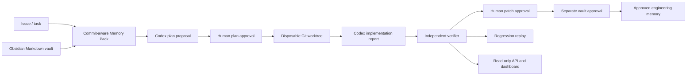

# Codex Foundry

> A local developer tool that puts AI coding (Codex) behind human plan approval, an isolated git worktree and an independent verifier, so an AI-proposed fix only counts as done when separate evidence proves it.

**Status:** Hackathon prototype built for OpenAI Build Week (July 2026). One recorded reference run (PAY-17, a duplicate-charge checkout bug); merge and deployment are not implemented.
**Demo:** [Demo video](https://youtu.be/5rJSPOZIT-Y) · Local: `npm ci && npm run demo`, then open http://127.0.0.1:4173

Codex Foundry is a local Developer Tool for **trustworthy AI-assisted software
engineering**. It turns an engineering task into bounded context, a
human-reviewed plan, a disposable candidate change, independent proof, and
reusable Markdown engineering memory.

It is not an autonomous deployer, a GitHub bot, or generic repository chat.
Its central rule is simple: **Codex can propose and implement within an
explicit boundary; only independent evidence and human approvals can establish
trust.**

## What Foundry Is

The shipped reference workflow is **PAY-17**, a deterministic duplicate-charge
checkout defect. At the frozen baseline, one logical checkout retry creates
two payments. Foundry presents the recorded repair as a complete trust chain:

```text
Issue → baseline Memory Pack → approved plan → disposable Codex candidate
→ independent verifier → patch approval → vault approval
→ approved engineering memory → regression replay
```

Foundry also contains two reusable local capabilities:

- **Repository Intelligence**: bounded, evidence-cited static analysis of a
  local Git repository before anyone authorizes AI planning. It does not run
  the target repository.
- **Policy-bound generic runs**: tested core primitives for caller-supplied
  tasks, baseline commits, allowed paths, and direct commands. They are not a
  second bundled live scenario and are not exposed as dashboard action buttons.

| Area | Current status |
|---|---|
| PAY-17 Reference Sandbox | Bundled, recorded, and executable locally. |
| Engineering Memory | Implemented and tested: Markdown index, graph, freshness, confidence, provenance, and token budgets. |
| Repository Intelligence | Implemented and tested; strictly read-only. |
| Generic policy-bound workflow | Implemented and tested as core primitives; requires a caller and human-reviewed policy. |
| Merge, deployment, production access | Not implemented by design. |

## Installation

```powershell
git clone https://github.com/HamzaKhanBUIC/codexfoundry.git
cd codexfoundry
npm ci
```

Requirements:

- Node.js 24.x
- npm 11.x or compatible
- Playwright Chromium, or installed Google Chrome for the documented browser
  fallback

`npm ci` installs root workspaces and the nested dashboard dependencies (via the `postinstall` script).

## Quick Start

From the repository root:

```powershell
npm run build
npm test
npm run demo
```

`npm run build` type-checks Memory and Foundry core, then builds the Vite
dashboard. `npm test` runs the Memory and Foundry-core suites; the dashboard
does not currently have a separate test script.

`npm run demo` validates the release evidence, materializes the immutable
fixture under ignored `.foundry-runtime/demo-store`, checks its baseline commit
and required commands, probes browser availability, then starts:

- Dashboard: `http://127.0.0.1:4173`
- Read-only API health: `http://127.0.0.1:4174/api/health`
- PAY-17 projection: `http://127.0.0.1:4174/api/runs/RUN-PAY-17-001`

## Architecture Overview



The dashboard separates the following views:

- **Reference Sandbox**: the immutable PAY-17 proof story, interactive proof
  graph, review, Memory Pack, and recorded evidence.
- **Analyze Repository**: Repository DNA, readiness assessment, static module
  and dependency facts, Architecture Explorer, risks, unknowns, and
  evidence-backed recommendations for a selected local Git repository.
- **Generic-run handoff**: a read-only view of a persisted generic run, if one
  exists. It shows the policy ceiling, plan, receipts, verification, and human
  gates but offers no control to advance the run.

For the complete boundaries, read [system design](architecture/system-design.md)
and [Repository Intelligence](architecture/repository-intelligence.md).

## How Codex Was Used

Codex is used as a **bounded engineering worker**, not as the source of truth.

- In a generic run, Codex planning receives a constrained task, Memory Pack,
  approved policy, and structured output schema in a read-only sandbox.
- Only after separate human plan approval may Codex implement inside a
  disposable worktree, limited to approved relative paths and direct approved
  commands.
- Codex implementation reports are recorded as non-authoritative claims.
  Foundry preserves the bounded prompt, response schema, raw structured output,
  and hashes when Codex is invoked.
- The independent verifier inspects the actual diff and reruns policy-approved
  commands. It alone can mark a proof as verified.
- Repository Intelligence can optionally invoke two read-only, citation-checked
  Codex semantic specialists. Their results are advisory and cannot authorize
  planning or execution.

The bundled PAY-17 candidate success is recorded independent-verifier evidence;
the release bundle does not include a checkout-able approved candidate worktree.

## How GPT-5.6 Was Used

Foundry contains GPT-5.6/Codex prompt contracts for structured planning and
implementation, plus optional read-only semantic reasoning in Repository
Intelligence. The generic Codex integration accepts an explicit model option
and stores an immutable invocation receipt when it runs.

The verified repository state does **not** claim a fresh, recorded GPT-5.6
response from this checkout. GPT-5.6/Codex output is always treated as an
untrusted proposal or advisory interpretation - not proof, approval, or a way to
bypass policy. This distinction is intentional and documented in the
[planner approval boundary](architecture/planner-approval.md) and
[Repository Intelligence design](architecture/repository-intelligence.md).

## Trust Boundaries

- Issues, repository files, and vault notes are untrusted input.
- Repository Intelligence is read-only: it may inspect bounded source and Git
  metadata, but never runs the target repository's scripts, builds, tests, or
  package-manager commands.
- A planner proposal cannot create a worktree. A separate human approval is
  required.
- Codex may write only inside an approved disposable worktree and only to
  approved paths.
- Verifier evidence - not Codex narration - owns proof status.
- Patch approval, vault-write approval, merge, and deployment are separate
  concerns. Foundry implements only the first two approvals; merge and deploy
  authority do not exist.
- The PAY-17 projection fails closed: missing required evidence returns
  `evidence_incomplete`; contradictory replay evidence returns
  `evidence_contradiction`.
- Dashboard and API routes are GET-only and read-only.

## Configuration

All variables are optional; no API keys are needed to run the demo.

| Variable | Default | Description |
| :--- | :--- | :--- |
| `FOUNDRY_PORT` | `4174` | Port of the read-only API (`foundry/src/local-server.ts`). |
| `FOUNDRY_CODEX_COMMAND` | `codex.cmd` on Windows, `codex` elsewhere | Path to the Codex CLI executable, used only when a Codex-backed step runs. |
| `FOUNDRY_GENERIC_RUN_DIRECTORY` | `foundry/runtime/generic-runs` | Where the API looks for persisted generic runs (`foundry/src/read-api.ts`). |
| `FOUNDRY_DEMO_STORE` | `.foundry-runtime/demo-store` | Location of the materialized demo fixture (`release/demo.mjs`). |

## Testing

```powershell
npm test
```

Runs the Memory suite (18 tests) and the Foundry-core suite (61 tests). The dashboard has no test script, and the repository has no CI workflow yet.

## Limitations

- The API is documented as GET-only, but it does not check the `Host` or `Origin` header, and `GET /api/engineering-pipeline?...&codex=true` starts a Codex CLI run. Run it only on a machine you trust, on localhost.
- `npm audit` reports a high-severity `js-yaml` 3.x issue (via `gray-matter`) that can cause high CPU on crafted vault frontmatter.
- The Codex-backed paths (`codex=true`) were not exercised in the last audit.
- The bundled PAY-17 run is a recording. The release bundle has no checkout-able approved candidate worktree.
- Only Windows 11 with Node 24 has been tested.
- The default branch is currently `codex/m4-proof-experience`; it is intended to become `main`.

## Supported Platforms

| Environment | Status |
|---|---|
| Windows PowerShell + Node 24 + npm 11 | **Verified locally**. This is the documented QA environment. |
| Browser proof with Playwright Chromium | Preferred runtime; install it when not already available. |
| Browser proof with stable Google Chrome | Documented fallback; the bootstrap reports a prerequisite clearly if neither browser is usable. |
| macOS or Linux | The TypeScript/Node project is portable in design, but this repository does not claim a full release validation on these platforms. |

## Try It in 5 Minutes

1. Install dependencies and run the build/test commands above.
   - Last recorded run: **18 Memory tests** and **61 Foundry-core tests**
     passed; the dashboard production build passed.
2. Run `npm run demo`, then open `http://127.0.0.1:4173`.
3. In **Reference Sandbox**, inspect the causal graph, Review, Memory Pack, and
   Evidence tabs. Confirm that Codex claims are visually distinct from
   independently verified evidence.
4. In the materialized fixture, reproduce the frozen defect:

   ```powershell
   Set-Location .foundry-runtime/demo-store
   npm run build
   npm run test:health
   npm run test:pay-17
   npm run test:browser
   ```

   Expected: build and health pass; `test:pay-17` exits `1` because it observes
   two payments; browser proof exits `0` because it successfully reproduces
   that known defect.
5. Optionally follow the reversible fail-closed evidence drill in the
   [Manual QA Guide](release/MANUAL_QA_GUIDE.md). It intentionally creates a
   valid-but-contradictory evidence claim, expects the API/dashboard to block
   the projection, and then restores the original file.

Do not claim a token-savings percentage, a rerunnable approved candidate, or a
browser trace/screenshot: the release artifacts do not establish those claims.

## Reference PAY-17 Evidence

| Artifact | Recorded value |
|---|---|
| Frozen baseline | `93ef28fa1737767a4a0c3b38fa8f9a6158980bb6` |
| Approved candidate | `63417cadd2ed28ec0a0dd7832be900285119c885` |
| Baseline proof | `npm run test:pay-17` exits `1`; it receives two payments. |
| Candidate proof | Build, health, PAY-17, and browser proof recorded exit `0`. |
| Regression replay | Reintroducing only the retry-key mutation makes the unchanged PAY-17 proof fail again. |

## Read More

1. [MVP scope](product/mvp.md)
2. [System design](architecture/system-design.md)
3. [Engineering Memory](architecture/memory.md)
4. [Repository Intelligence](architecture/repository-intelligence.md)
5. [Core README](foundry/README.md) and [Dashboard README](foundry/dashboard/README.md)
6. [Manual QA guide](release/MANUAL_QA_GUIDE.md)
7. [Documentation status](release/DOCUMENTATION_STATUS.md)
8. [Architecture decisions](ARCHITECTURE_DECISIONS.md)

## License

MIT. See [LICENSE](LICENSE).
