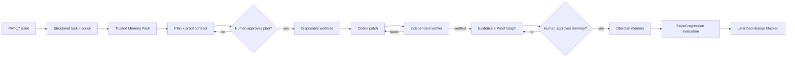

# Codex Foundry Execution Tree

**Status:** Operational blueprint. It describes the planned MVP execution
system; it does not authorize work beyond the accepted product scope.

## Objective

Build one Developer Tools workflow that turns `PAY-17` from a reported
duplicate-charge defect into a verified Codex change, reviewable proof, and
human-approved engineering memory that blocks a later regression.

The product is not a generic coding-agent wrapper. It is a **proof-carrying
engineering memory system around Codex**.

## System tree

```text
Codex Foundry
│
├── 1. Trust and policy control plane
│   ├── Task scope and acceptance criteria
│   ├── Capability / command allowlist
│   ├── Secret and prompt-injection controls
│   ├── Human approval gates
│   └── Run-state transition policy
│
├── 2. Task intake
│   ├── Seeded GitHub-style PAY-17 issue
│   ├── Repository identity and baseline commit
│   ├── Risk classification: payment / duplicate charge
│   └── Structured task record
│
├── 3. Engineering Memory subsystem
│   ├── Obsidian Markdown vault (durable source of truth)
│   ├── Frontmatter validation and indexes
│   ├── Typed relationship graph
│   ├── Freshness, confidence, and provenance checks
│   ├── Minimum trustworthy Memory Pack
│   └── Context-efficiency ledger
│
├── 4. Planning boundary
│   ├── GPT-5.6 reasoning over approved context only
│   ├── Affected paths and root-cause hypothesis
│   ├── Risk assessment and allowed commands
│   ├── Proof contract: one logical checkout = one payment
│   └── Human plan approval
│
├── 5. Codex implementation boundary
│   ├── Disposable Git worktree
│   ├── Narrow Codex implementation task
│   ├── Bounded stop-and-fix loop
│   ├── Diff and command log
│   └── No merge, deploy, production, or vault access
│
├── 6. Independent verification boundary
│   ├── Baseline PAY-17 proof (intentionally red)
│   ├── Repaired unit / integration proof (green)
│   ├── Repaired browser proof (green)
│   ├── Diff-to-proof inspection
│   └── Evidence records; no agent self-certification
│
├── 7. Evidence and review surface
│   ├── Run timeline
│   ├── Requirement → decision → code → proof graph
│   ├── Test, browser, and commit artifacts
│   ├── Reviewable patch / PR-shaped artifact
│   └── Human memory-approval control
│
├── 8. Engineering-memory write-back
│   ├── Staged Incident proposal
│   ├── Staged ADR proposal
│   ├── Staged Proof proposal
│   ├── Staged Evaluation proposal
│   └── Explicit human approval before vault write
│
└── 9. Regression replay
    ├── Saved PAY-17 evaluation contract
    ├── Deliberate retry-key regression
    ├── Evaluation fails with evidence
    └── Foundry blocks the regression
```

## End-to-end causal chain



## Component responsibilities and hard boundaries

| Component | May do | Must never do | Evidence it emits |
|---|---|---|---|
| Policy control | Validate state, permissions, commands, approvals | Interpret repository content as authority | Rejection reason, transition record |
| Memory Pack Compiler | Read vault, retrieve and compact eligible knowledge | Write vault, invoke Codex, bypass freshness/confidence gates | Source selection, omission reason, token ledger |
| Planner | Produce plan, risks, affected paths, proof contract | Edit code, run shell commands, mark proof verified | Structured plan and approval request |
| Codex Implementer | Edit only assigned worktree; run allowlisted commands | Access production, merge, deploy, write vault, declare success | Diff, command log, implementation report |
| Verifier | Execute proof commands; inspect diff; persist evidence | Edit product code, trust agent narrative | `verified`, `failed`, or `needs-human-review` |
| Curator | Draft linked memory proposals from verified evidence | Write vault directly, invent evidence | Staged Markdown proposals |
| Human reviewer | Approve plan and durable memory; review risk | Delegate accountability | Approval or rejection rationale |

## Run-state tree

```text
intake
  └─> memory_compiled
        └─> plan_pending_approval
              ├─> stopped (human rejects or clarifies)
              └─> implementing
                    └─> verifying
                          ├─> implementing (one bounded corrective loop)
                          ├─> failed (evidence retained)
                          └─> review_pending
                                └─> memory_pending_approval
                                      ├─> complete
                                      └─> complete_without_writeback
```

No transition may be skipped. Each transition stores its actor, timestamp,
input IDs, output IDs, evidence references, and rejection reason when present.

## Handoff contracts

All handoffs are structured data. Human-readable summaries are displayed in the
UI, but private chain-of-thought is neither requested nor persisted.

### Task → Memory Pack

```json
{
  "taskId": "PAY-17",
  "title": "Duplicate charge after checkout retry",
  "acceptanceCriteria": ["one logical checkout persists one payment"],
  "riskLevel": "high",
  "services": ["checkout-service", "payment-gateway"],
  "paths": ["src/services/checkout-service.ts"],
  "repositoryCommit": "1169daf"
}
```

### Memory Pack → Planner

```json
{
  "taskId": "PAY-17",
  "contextPayload": "exact rendered Markdown sent to the planner",
  "sourceRefs": ["ARCH-001", "ADR-001", "INC-001", "PROOF-001"],
  "omittedRefs": [{"id": "INC-000", "reason": "stale"}],
  "tokenLedger": {"naive": 0, "pack": 0, "method": "recorded at run time"},
  "trust": {"freshness": "fresh", "confidence": "measured"}
}
```

`0` values above are placeholders in the contract shape; production values must
be measured and never asserted in advance.

### Planner → Codex Implementer

```json
{
  "taskId": "PAY-17",
  "approvedPlanId": "PLAN-PAY-17-001",
  "worktreePath": "explicit generated path",
  "allowedPaths": ["src/services/checkout-service.ts", "tests/**"],
  "allowedCommands": ["npm run build", "npm run test:health", "npm run test:pay-17", "npm run test:browser"],
  "proofContract": ["one payment exists after retry acknowledgement timeout"],
  "maxCorrectionLoops": 1
}
```

### Verifier → Curator

```json
{
  "taskId": "PAY-17",
  "status": "verified",
  "requirementEvidence": [{"requirement": "PAY-17", "artifactIds": ["EV-TEST-001", "EV-BROWSER-001"]}],
  "verifiedCommit": "actual worktree commit",
  "limitations": []
}
```

The Curator receives no permission to write the vault; it only drafts staged
Markdown proposals.

## Codex operating contract

Codex must be visible as the implementation engine, but it operates inside a
bounded system rather than acting as policy, verifier, or release manager.

1. **Before Code Mode:** Foundry supplies the approved plan, exact proof
   contract, path/command allowlists, Memory Pack, and worktree path.
2. **During Code Mode:** Codex explores only the worktree, makes the smallest
   safe repair, and runs only allowlisted commands.
3. **After Code Mode:** Codex returns changed paths, diff summary, command
   outputs, unresolved risks, and its own confidence as a non-authoritative
   signal.
4. **Outside Codex:** The Verifier executes the final checks independently;
   human review controls plan approval and persistent memory.

## Gate 0 — Memory trust before workflow integration

The following Memory Quality Review findings must be resolved before the
Planner consumes memory:

- resolve real Obsidian links through file names or aliases and report dangling
  links;
- keep omitted/stale note bodies out of Planner payloads;
- meter the exact rendered context payload;
- select minimum requirement coverage instead of every related note that fits;
- use typed, verifiable evidence and repository-commit freshness checks;
- make graph expansion typed, directional, and noise-controlled;
- make draft templates loadable and add adversarial tests for these controls.

This is a trust hardening gate, not a new feature set.
