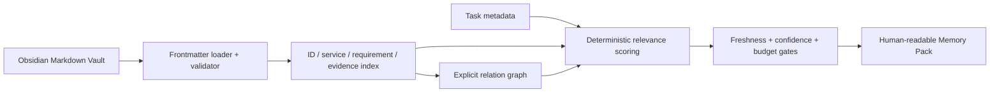

# Memory Subsystem — Milestone 2

## Boundary

The memory subsystem is a local TypeScript library at `memory/`. It reads the
seeded sibling Obsidian vault at `vault/` and returns an in-memory index,
relationship graph, and Markdown Memory Pack. It does not write to the vault,
read the demo repository, call a model, execute commands, or manage agents.

## Data flow

## Source of truth

The vault is the source of truth for durable engineering memory. The index and
graph are derived on load, never persisted as a competing database. Every
relation retains the originating document ID or source path.

## Selection policy

The compiler scores direct matches against task requirements, services, tags,
evidence paths, title/body terms, and explicitly requested document IDs. It
then admits linked memory up to two graph hops. Documents are rejected by
default when stale, unverified, below the confidence threshold, or too large
for the 12,000-token default budget. The rendered pack identifies every source
and every omission.

## Forward compatibility

Later Foundry services can persist a rendered pack and its metadata in SQLite,
show it in the UI, or submit its vetted candidates to a bounded GPT-5.6 ranker.
Those integrations must not bypass deterministic provenance, freshness,
confidence, or approval rules.
