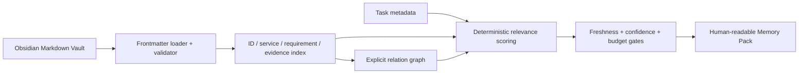

# Memory Subsystem — Milestone 2

## Boundary

The memory subsystem is a local TypeScript library at `memory/`. It reads the
seeded sibling Obsidian vault at `vault/` and returns an in-memory index,
relationship graph, and Markdown Memory Pack. It does not write to the vault,
read the demo repository, call a model, execute commands, or manage agents.

## Data flow

## Source of truth

The vault is the source of truth for durable engineering memory. The index and
graph are derived on load, never persisted as a competing database. Every
relation retains the originating document ID or source path.

Obsidian links resolve through stable IDs, filename stems, vault-relative path
stems, and explicit frontmatter aliases. Unresolved links are retained as
source-attributed `danglingLinks` diagnostics, rather than being silently
treated as memory graph nodes.

## Selection policy

The compiler scores direct matches against task requirements, services, tags,
evidence paths, title/body terms, and explicitly requested document IDs. It
then selects the smallest set that covers explicit task signals. A relevant
Proof is retained as an executable trust anchor. Graph expansion is limited to
one outbound `links-to` hop from selected direct context, and only admits a
linked document when it covers an unmet obligation. Documents are rejected by
default when stale, unverified, below the confidence threshold, or too large
for the 12,000-token default budget. The rendered planner payload contains the
bodies of selected sources only; every omission is bodyless metadata with its
ID, title, freshness, confidence, and reason. Its token estimate is measured
from that exact rendered payload. The rendered pack identifies every source
and every omission. If even this safe payload exceeds the requested budget, the
compiler fails closed with the measured minimum instead of returning an
over-budget pack.

Evidence is structured as a typed reference with an explicit verification flag;
only verified typed references increase confidence. Legacy string evidence is
readable for migration but is unverified. A task repository commit is a
freshness input: notes lacking a matching `verified_commit` become stale. A
short Git hash and its full hash identify the same commit only when both are at
least seven characters and one is a prefix of the other.
Draft templates may contain blank optional YAML values; they load safely but
remain unverified and excluded from normal packs.

## Forward compatibility

Later Foundry services can persist a rendered pack and its metadata in SQLite,
show it in the UI, or submit its vetted candidates to a bounded GPT-5.6 ranker.
Those integrations must not bypass deterministic provenance, freshness,
confidence, or approval rules.
