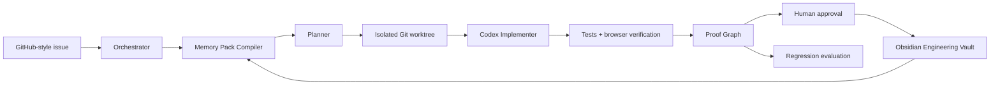

# System Design

## Boundaries

- The orchestrator may read the demo repository and vault.
- Only the isolated worktree is writable by the implementation agent.
- Vault writes are staged and require user approval.
- The verifier is the sole authority that may mark a proof `verified`.
- No production credentials, deployment access, or automatic merge capability exist.

## Generic local-run boundary

The generic workflow is a second execution contract, not an extension of the
Repository Intelligence endpoint. Its caller must supply an explicit task and
a human-reviewed policy that pins a clean Git commit, allowed relative paths,
and direct command specs. Codex plans in a read-only sandbox and implements
only in a disposable candidate worktree after distinct human plan approval.
The implementation report is non-authoritative; the verifier checks the
actual diff and executes only approved commands. Patch and vault approvals are
separate. Run state is persisted as Foundry-owned JSON evidence, and the
dashboard may read it but has no action endpoint.

## Core services

1. Web application: task intake, agent timeline, proof graph, review controls.
2. Orchestrator: durable state machine for the PAY-17 reference run and
   Foundry-owned evidence records for policy-bound generic local runs.
3. Memory Pack Compiler: selects structured vault notes and repository facts.
4. Worktree Runner: manages the disposable checkout and command allowlist.
5. Verifier: executes test and browser proof commands.
6. Vault Adapter: reads Markdown and stages approved note updates.

## Dual-mode dashboard boundary

The landing page separates two contracts. Reference Sandbox renders the fixed,
evidence-validated PAY-17 projection. Repository Analysis calls a loopback,
read-only endpoint for a user-selected local Git repository. The analyzer uses
only filesystem reads and read-only Git commands, caps scanning, reports
unknown areas rather than guessing, and reuses the Markdown Memory Pack
compiler. It cannot cross into planner approval, worktree creation,
verification, or vault writes. An explicit request may invoke read-only Codex
semantic specialists against a bounded static-evidence pack; their
citation-checked results remain advisory and grant no execution authority.

The intelligence report carries evidence, confidence, explicit reasoning,
cross-references, unknowns, and limitations for Git, language/framework,
package, entrypoint, module, dependency, architecture/domain, build/test,
security/debt, complexity, duplicate, dead-code-candidate, health, Memory
Pack, and backlog sections. Its Architecture Explorer adds entity-level static
imports/exports, direct dependency references, related risks/recommendations,
and reverse-graph change-impact estimates without adding an execution path. A
deterministic decision layer derives Repository DNA, a planning-readiness
recommendation, an executive briefing, and a story from those same facts.
Health is an explainable report card and backlog items are ranked engineering
context only; neither the report nor readiness is a plan or grants action
authority. See [Repository Intelligence](repository-intelligence.md) for the
static-analysis boundary and its non-claims.
