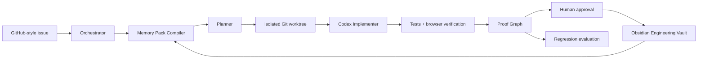

# System Design

## Boundaries

- The orchestrator may read the demo repository and vault.
- Only the isolated worktree is writable by the implementation agent.
- Vault writes are staged and require user approval.
- The verifier is the sole authority that may mark a proof `verified`.
- No production credentials, deployment access, or automatic merge capability exist.

## Core services

1. Web application: task intake, agent timeline, proof graph, review controls.
2. Orchestrator: durable state machine for the one task run.
3. Memory Pack Compiler: selects structured vault notes and repository facts.
4. Worktree Runner: manages the disposable checkout and command allowlist.
5. Verifier: executes test and browser proof commands.
6. Vault Adapter: reads Markdown and stages approved note updates.
