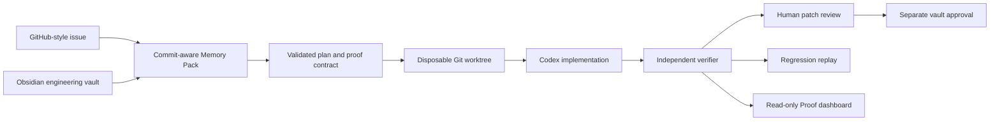

# Codex Foundry — Master Project, Competition, and Engineering Handoff

**Audience:** the next Lead Architect, implementation agent, reviewer, and
release agent.

**Current release branch:** `codex/m4-proof-experience`; verify `HEAD` before
making release claims.

**Frozen fixture baseline:** `demo-store` commit
`1169dafdc3d1f18fed2adca11ce900a15a67cfd3`.

**Status:** Milestones 1–4 and Release Tier 2 are implemented on the release
branch. The product is not merged to `main` by design. The next work is Tier 3
judge documentation, polish, and final readiness validation.

---

## 1. What We Are Building

### Product

**Codex Foundry — The Engineering Memory & Proof System**.

One-line pitch:

> Codex Foundry transforms every engineering task into verified code changes,
> executable proof, and reusable engineering memory so every future Codex task
> becomes smarter, safer, and more efficient.

Foundry is deliberately **not** another generic coding chatbot, generic
repository Q&A tool, autonomous merge bot, or documentation database. It is a
bounded engineering workflow that makes a Codex-assisted change reviewable and
causally provable:



### The one MVP scenario

PAY-17 is a high-impact duplicate-payment checkout defect. A payment gateway
captures the first charge, then deterministically returns an acknowledgement
timeout. `CheckoutService` retries using a mutated idempotency key, so it
creates a second capture. There is no randomness or race condition.

The causal proof chain is intentionally easy to understand:

1. The frozen baseline fails PAY-17: expected one payment, received two.
2. Codex receives a bounded plan and makes a repair only in a disposable
   worktree.
3. An independent verifier reruns the unchanged proof and browser scenario.
4. A human approves the exact candidate patch; this is not a merge.
5. A second human approval authorizes four Markdown memory revisions.
6. Foundry deliberately reintroduces the same retry-key mutation in a new
   disposable candidate; the saved evaluation catches it.

That is a complete proof of useful, safe AI-native engineering rather than a
single model claim that a patch "looks correct."

---

## 2. Competition Positioning and First-Place Strategy

### Track and intended audience

This project is prepared for the **OpenAI Build Week Developer Tools track**.
It is designed for judges who need to see that Codex is central to the product,
not merely called behind a generic interface. The target audiences are:

- OpenAI Build Week judges evaluating technical depth, Codex use, product
  clarity, and execution quality.
- Senior engineering leaders who need an auditable path from issue to repair.
- Developers who need future AI tasks to inherit reliable engineering context
  without receiving the entire codebase or untrusted history.

### Why this can compete at the top

The competitive claim is not "we made an agent write code." Many submissions
will do that. Foundry shows the missing infrastructure around an AI coding
agent:

| Typical AI coding agent | Codex Foundry advantage |
|---|---|
| Produces a patch and a narrative | Produces an evidence-linked patch, proof contract, verifier record, and replayable evaluation. |
| May absorb broad, stale context | Compiles the smallest trustworthy, commit-aware Markdown Memory Pack. |
| Treats tool output as success | Separates implementer claims from independent verifier authority. |
| Has one vague approval step | Separates patch approval, candidate commit, and durable vault-write approval. |
| Forgets lessons after a task | Stores portable Obsidian notes with typed evidence, stable IDs, freshness, and provenance. |
| Cannot demonstrate future protection | Reintroduces the exact causal defect in a disposable candidate and proves the evaluation blocks it. |

### First-place execution principles

1. **Show a real defect, not a toy prompt.** Duplicate charges are concrete,
   expensive, and instantly understood.
2. **Make Codex visible but bounded.** Its plan and implementation are useful;
   neither is mistaken for evidence or authority.
3. **Show causality in seconds.** Baseline red → candidate green → regression
   red is the core judge story.
4. **Be unusually honest.** Never fabricate token savings, screenshots,
   browser traces, verification, or autonomous actions.
5. **Make memory a product advantage.** Explain why the exact repair task gets
   selected fresh evidence and omits stale future-repair knowledge.
6. **Prefer one exceptional workflow over broad unfinished scope.** No cloud
   deployment, GitHub App, automatic merge, generic agent marketplace, or
   multiple scenarios before the core demo is polished.

### The intended three-minute judge narrative

1. A checkout bug creates two visible charges after a retry.
2. Foundry takes the issue and compiles a small, evidence-backed Memory Pack;
   stale future knowledge is excluded.
3. Codex works in a disposable candidate under an approved plan.
4. The verifier, not Codex, proves the unchanged test and browser scenario now
   produce one charge.
5. The reviewer sees exact diff, proof contract, evidence, and separate
   approval limits.
6. Foundry saves approved Incident/ADR/Proof/Evaluation memory.
7. Reintroducing the retry-key mutation causes the saved evaluation to fail.

The dashboard must help this story; it must never pretend to be a control plane
or conceal the human gates.

---

## 3. Current Stage and Delivery State

| Stage | Status | Outcome |
|---|---|---|
| Milestone 1 — deterministic demo repository | Complete and frozen | Production-shaped ecommerce fixture with deterministic PAY-17 defect. |
| Milestone 1 audit fixes | Complete | Parallel-safe browser sessions, idempotency-key lifecycle, suite separation, browser fallback, clean baseline. |
| Milestone 2 — Engineering Memory | Complete | Obsidian-compatible schemas, deterministic index/graph/compiler/scoring. |
| Gates 0–3 / Milestone 3 workflow | Complete | Trusted intake, persisted pack, plan contract, worktree policy, verification, approvals, vault revisions, regression replay. |
| Milestone 4 — proof experience | Complete | Read-only dashboard, projection, local read API, grounded Memory Pack metrics, responsive graph, and typed graph inspection. |
| Release Tier 1 | Complete on release branch | One-command demo bootstrap, immutable fixture bundle, provenance/browser preflight. |
| Release Tier 2 | Complete | Every declared graph node and edge is inspectable through typed, evidence-derived, keyboard-accessible, read-only details. |
| Release Tier 3 | Pending | Judge instructions, loading/error states, visual polish, final readiness report. |
| Merge to `main` | Pending explicit instruction | `main` intentionally remains untouched. Do not merge automatically. |

### Current release commitments

- Branch: `codex/m4-proof-experience`
- Latest release integration commit: `520de8a`
- Evidence-grounding fixes: `f54bf84`
- Frozen demo fixture is unchanged at baseline `1169daf…`
- Approved repair candidate remains detached at `2a5d01f…`
- Release bootstrap: `npm run demo`

---

## 4. Complete Feature Inventory

### A. Deterministic ecommerce fixture — Milestone 1

Location: `demo-store/` in its independently frozen Git repository.

- Checkout page and cart.
- Express API layer.
- Checkout, payment, order, and retry services.
- Intentional retry/idempotency root cause isolated in `CheckoutService`.
- Deterministic payment gateway timeout-after-capture behavior.
- Session isolation through `x-demo-session-id`; a reset cannot affect another
  browser worker.
- Fresh client idempotency key for a new logical checkout; retries retain the
  logical key. The service mutation remains intentionally defective.
- Split commands:
  - `npm run test:health` — green health suite.
  - `npm run test:pay-17` — intentionally red baseline proof.
  - `npm run test:browser` — browser reproduction/acceptance proof.
- Browser runner prefers bundled Playwright Chromium and falls back to stable
  Chrome with an explicit message.
- Fixture README, architecture notes, seeded PAY-17 issue, reproduction steps,
  and test support.

### B. Engineering Memory — Milestone 2

Locations: `memory/`, `vault/`, `architecture/memory-subsystem.md`.

- Obsidian-compatible Markdown vault divided into Architecture, Service, ADR,
  Incident, Proof, and Evaluation notes.
- Validated YAML frontmatter: stable IDs, services, requirements, typed
  evidence, verified commit/time, confidence, freshness/staleness, relations.
- Markdown parser, typed document model, deterministic index, and explicit
  graph derived from frontmatter and Obsidian links.
- Deterministic relevance scoring by requirement, service, path, and link.
- Confidence calculation only promotes typed, verified evidence.
- Commit-aware freshness rejects notes verified against missing/different
  commits; this prevents future repair knowledge leaking into baseline repair
  analysis.
- Token-budget enforcement uses rendered Markdown measurement, not invented
  estimates.
- Minimum-coverage selection chooses the smallest trustworthy source set;
  graph expansion is bounded to unmet proof obligations.
- Human-readable Memory Pack with inclusion reasons and bodyless omission
  reasons/provenance.

### C. Trusted orchestration and proof — Milestone 3

Location: `foundry/`.

- Local Node SQLite run store, durable run state machine, and append-only
  transition history.
- Validated frozen repository map pinned to PAY-17 baseline and known paths/
  allowed commands.
- Safe issue intake that treats issue prose as untrusted content.
- Persisted, hashable Memory Pack input artifact; planner may receive only this
  rendered pack and bodyless omission metadata, never raw vault/index.
- Bounded structured planner contract: exact JSON, validated paths/commands/
  proof assertion, and required human plan approval.
- Disposable detached Git worktree lifecycle and command allowlist.
- Bounded Codex implementer report contract. The report is explicitly
  non-authoritative.
- Independent verifier compares baseline failure, candidate success, approved
  diff boundary, and unchanged PAY-17 proof contract.
- Review artifact for human patch decision without merge/deploy authority.
- Candidate repair commit: `2a5d01f47b1ebdbe0ed97633474d2e19adf4b10b`.
- Staged then explicitly approved revisions for Incident, ADR, Proof, and
  Evaluation vault documents. Stable IDs are retained.
- Regression replay: a separate disposable candidate restores only the
  retry-key mutation and is marked `regression_blocked` when the unchanged
  proof fails.

### D. Judge proof experience — Milestone 4

Locations: `foundry/dashboard/`, `foundry/src/run-evidence-projection.ts`,
`foundry/src/local-server.ts`.

- React + Vite + Fluent UI dashboard designed as a dense, read-only proof
  review surface.
- Tabs: Proof story, Review, Memory Pack, Evidence.
- Versioned `FoundryRunProjection` (`1.0`) derived from recorded artifacts;
  components do not invent workflow facts.
- Local loopback read API:
  - `GET /api/health`
  - `GET /api/runs/RUN-PAY-17-001`
  - Unknown routes return `404`; non-GET actions return `405`.
- Vite same-origin `/api` proxy. Direct cross-origin API fetch is intentionally
  unsupported.
- Review view shows candidate commit/diff scope, proof contract, verifier
  evidence, approval limits, vault targets, and limitations.
- Evidence view labels implementer output separately from independent verifier
  evidence and provides expandable artifact records.
- Memory Pack view consumes recorded compiler snapshot data, including:
  - measured 715 token pack size;
  - 12,000 token budget;
  - confidence `1`;
  - selected source `PROOF-001`;
  - recorded omissions and reasons;
  - explicit statement that no naïve-context baseline was recorded.
- Browser evidence honestly states when no screenshot or trace was recorded.
- Mobile Proof Graph stacks vertically so later proof stages remain discoverable.
- The graph supports keyboard and pointer inspection of every declared node
  and edge. The core fails closed when a declared graph item lacks its typed
  inspector record; no graph interaction has action authority.

### E. Release integration — Tier 1

Locations: root `package.json`, `release/demo.mjs`,
`release/demo-store.bundle`, `release/demo-store-manifest.json`.

- `npm run demo` validates expected Foundry/evidence files.
- The immutable demo fixture is packaged as a **baseline-only Git bundle**;
  no candidate or regression worktree refs are included.
- Bootstrap materializes the fixture under ignored `.foundry-runtime/demo-store`
  rather than writing the source fixture.
- It verifies the exact baseline commit and required npm scripts.
- It installs missing dependencies, probes bundled Chromium then Chrome
  fallback, starts API/dashboard, health-checks API, prints URLs, and handles
  Ctrl+C cleanup (including Windows process-tree cleanup).
- ADR-028 records why bundle packaging was chosen over a submodule, copying,
  or remote dependency.

---

## 5. Trust Boundaries and Invariants

### Authority model

| Component | May do | Must never be treated as |
|---|---|---|
| Issue/repository/vault content | Provide untrusted input | Policy, permission, or system instruction |
| Memory compiler | Select bounded, explainable context | A mechanism to bypass freshness/confidence gates |
| Planner / Codex | Propose plan and patch | Proof or execution authority |
| Worktree runner | Mutate a disposable candidate under allowlist | A writer to frozen baseline or vault |
| Independent verifier | Run approved proof and determine verification | A generic agent or merge authority |
| Human patch review | Approve/reject exact verified candidate | Merge/deploy or vault approval |
| Vault approval | Authorize staged Markdown revisions | Implicit patch or merge approval |
| Dashboard/API | Read evidence | A command, approval, vault-write, Git, or merge control plane |

### Non-negotiable invariants

1. Never modify frozen `demo-store` baseline or remove PAY-17 before the
   submission recording.
2. Work only in a designated disposable worktree for implementation.
3. Do not claim verification without actual command or browser evidence.
4. Verifier is the sole source allowed to mark a proof `verified`.
5. Planner receives only rendered, persisted Memory Pack context.
6. Vault updates must be staged and explicitly user-approved.
7. Patch approval, candidate commit, and vault write remain separate gates.
8. Preserve Markdown-first vaults, stable IDs, typed evidence, and explicit
   links.
9. No automatic merge/deploy, production credentials, cloud CI provisioning,
   or unrestricted repository/GitHub integration in this MVP.
10. Append material architecture changes to `ARCHITECTURE_DECISIONS.md`.

---

## 6. Evidence and Validation Inventory

### Latest passing validation

| Area | Command / result |
|---|---|
| Memory | `npm test` — 18/18 passed; `npm run build` passed. |
| Foundry core | `npm test` — 27/27 passed across 11 files; `npm run build` passed. |
| Dashboard | `npm run build` passed with strict TypeScript and Vite. |
| Frozen baseline | Build and `test:health` pass. `test:pay-17` intentionally fails: expected 1, received 2. Browser proof passes showing two payments. |
| Approved candidate | Build, health, PAY-17 unit test, and browser proof pass; browser observes one payment. |
| Regression replay | Reintroduced retry mutation causes unchanged PAY-17 proof to fail as expected. |
| Release fixture | Bundle verifies; materialized clone is exactly `1169daf…`; browser proof passes through Chrome fallback in this environment. |
| Dashboard QA | Dashboard API, tabs, mobile responsiveness, negative routes, and no browser console/page errors were tested. |

### Evidence artifacts

The authoritative recorded run artifacts live in `foundry/evidence/`:

- `RUN-PAY-17-001-implementation.json`
- `RUN-PAY-17-001-verifier.json`
- `RUN-PAY-17-001-human-approval.json`
- `RUN-PAY-17-001-vault-write.json`
- `RUN-PAY-17-001-regression-replay.json`
- `RUN-PAY-17-001-memory-pack.json`

Do not substitute a narrative summary for these artifacts. The dashboard
projection exists to make their facts reviewable, not to become their source.

---

## 7. QA History: Resolved vs Remaining

The historical `release/FINAL_QA_REPORT.md` correctly recorded a **62/100,
NOT READY** state at the time. It must not be read as the current score without
this update.

| QA item | Current state |
|---|---|
| QA-01: release clone lacked fixture | Resolved by `520de8a`: baseline-only bundle + manifest + materialized local clone. |
| QA-02: one-command demo could not validate live fixture | Resolved by `520de8a`: commit/scripts/browser preflight before API/dashboard readiness. |
| QA-03: Memory Pack facts were hard-coded | Resolved by `f54bf84`: recorded compiler snapshot drives values and omission metadata. |
| QA-04: graph not interactive | Resolved: typed, evidence-derived node/edge inspectors with native controls, keyboard access, and no write authority. |
| QA-05: mobile graph clipped | Resolved by `f54bf84`: vertical mobile graph. |
| QA-06: browser evidence implied a visual artifact | Partially resolved by `f54bf84`: UI explicitly says no screenshot/trace exists. A real artifact remains optional and may only be shown after actual capture. |
| QA-07: no grounded memory metrics | Resolved by `f54bf84`: pack size/budget/confidence shown; naïve baseline honestly unavailable. |
| QA-08: direct API CORS | No fix required; Vite proxy is the supported same-origin route. |

---

## 8. Repository Map

```text
OpenAI Build Week-m4/                 # Current release worktree
├── product/                          # MVP scope and vision
├── architecture/                     # system, memory, security specifications
├── implementation/                   # task board/milestones
├── memory/                           # typed Markdown memory compiler + tests
├── vault/                            # Obsidian engineering memory
├── foundry/                          # workflow core, evidence, local read API
│   ├── evidence/                     # authoritative recorded PAY-17 artifacts
│   ├── src/                          # state/policy/projection/API
│   ├── tests/                        # core contracts
│   └── dashboard/                    # Fluent UI judge proof experience
├── release/                          # bundle, bootstrap, QA/release/handoff docs
├── ARCHITECTURE_DECISIONS.md         # ADR-001 through ADR-029
└── package.json                      # `npm run demo`

OpenAI Build Week/demo-store/         # Separate, frozen source fixture
```

---

## 9. Exact Next Work — Do Not Expand Scope

### Next: Tier 3 release hardening

- Add concise judge README and one-command run instructions.
- Verify loading, empty, and network-error states without fabricating evidence.
- Capture a browser screenshot or trace only by running the final real scenario
  with capture enabled; otherwise retain the explicit absence label.
- Run full release validation and produce `release/RELEASE_READINESS.md` with
  an evidence-backed score and remaining limitations.
- Never add approval buttons, commands, vault writes, merge controls, or API
  writes.

## 10. Guidance for the Next AI Agent

1. Start by reading `AGENTS.md`, then the required reading order:
   `product/mvp.md`, `architecture/system-design.md`,
   `architecture/memory.md`, `architecture/security.md`,
   `implementation/task-board.md`, and `ARCHITECTURE_DECISIONS.md`.
2. Work in `OpenAI Build Week-m4` / branch `codex/m4-proof-experience`, not
   the original root or frozen fixture.
3. Treat this document as current release context, but verify Git status and
   exact commits before making claims.
4. Do not rework solved QA-01/02/03/05/07. They are already represented in
   release commits and must not be replaced with weaker static claims.
5. Keep output concise to the user but record material design choices in ADRs.
6. Every visible judge claim must be backed by a command result, commit,
   evidence artifact, or approved vault note.

## 11. Honest Overall Assessment

**Architecture:** strong and unusually disciplined for a hackathon MVP.

**Implementation:** complete for the narrow deterministic workflow, with a
real local release bootstrap and independently replayed proof chain.

**Differentiation:** high. The combination of commit-aware memory, verifier
authority, separated approvals, Markdown durability, and causal regression
replay is the central reason this can stand out in a highly competitive
Developer Tools field.

**Remaining risk:** not breadth, but presentation and release discipline. The
project must make the one-command path effortless for judges and avoid
unsupported performance or security claims.

**Decision:** continue with the existing roadmap. Do not generate new product
ideas or broaden scope before Tier 3 is complete.
