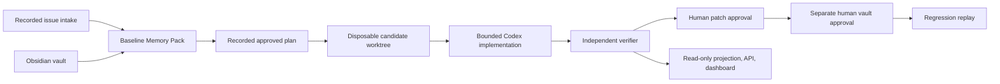

# Codex Foundry — Current Project Handoff

**Use this document as the authoritative current-state reference.** Verify
`git status --short` and `git rev-parse HEAD` before making a commit-specific
release claim. Historical reports are catalogued in
[DOCUMENTATION_COMPARISON.md](DOCUMENTATION_COMPARISON.md).

## Product in one paragraph

Codex Foundry is a Developer Tools MVP for trustworthy AI-assisted engineering,
not a generic coding chatbot. Its one complete workflow starts with PAY-17, a
duplicate-charge checkout retry defect. Foundry constrains planning through a
commit-aware Memory Pack, constrains Codex to a human-approved disposable
worktree, treats independent verification—not agent narration—as proof, keeps
patch and vault approvals separate, stores approved learning as typed Obsidian
Markdown, and proves the learning by reintroducing the causal defect in a
separate candidate where the unchanged test blocks it.

## Supported workflow



## Current recorded PAY-17 facts

| Item | Value |
|---|---|
| Frozen fixture baseline | `93ef28fa1737767a4a0c3b38fa8f9a6158980bb6` |
| Approved candidate | `63417cadd2ed28ec0a0dd7832be900285119c885` |
| Proof contract | `one logical checkout persists one payment` |
| Baseline result | PAY-17 test fails: expected one payment, received two |
| Candidate result | build, health, PAY-17, and browser proof pass |
| Regression result | Restored retry-key mutation makes unchanged PAY-17 proof fail |
| Post-repair Memory Pack | 715 estimated tokens / 12,000 budget / confidence 1 |
| Baseline planner pack | `PACK-PAY-17`, 634 estimated tokens / 12,000 / confidence 0.88; `ARCH-001` only |

The new intake/plan artifacts are labelled `historical-contract-replay`: they
materialize deterministic evidence for the completed historical run and do not
claim a new issue submission or planner invocation.

## Implemented components

| Component | Location | Current responsibility |
|---|---|---|
| Frozen fixture | `demo-store/` and `release/demo-store.bundle` | Deterministic checkout defect, split test commands, browser proof. |
| Memory | `memory/`, `vault/` | Markdown schema, index/graph, relevance, freshness, confidence, token budget, rendered pack. |
| Foundry core | `foundry/src/` | SQLite state, intake, Memory Pack persistence, planner/worktree policy, projection, loopback API. |
| Evidence | `foundry/evidence/` | Run-linked stage records, verifier proof, approvals, memory snapshot, replay. |
| Dashboard | `foundry/dashboard/` | Read-only proof graph, Review, Memory Pack, Evidence, six-stage source list. |
| Release bootstrap | `release/demo.mjs` | Bundle materialization, provenance/command/browser preflight, local API and dashboard startup. |

## Trust boundaries that must not change

- Frozen baseline remains unchanged and intentionally defective.
- Only an approved disposable candidate may be changed by implementation.
- Planner and implementer output are untrusted; the verifier alone marks proof
  `verified`.
- Patch approval does not merge, deploy, or approve a vault write.
- Vault writes require a separate explicit human approval.
- Dashboard and API are read-only; no endpoint changes Git, vault, run state,
  or production systems.
- Evidence projection fails closed: incomplete evidence returns
  `evidence_incomplete`; contradictory replay evidence returns
  `evidence_contradiction`.

## Commands and validation

```powershell
# Root release checks
npm install
npm run build
npm test
npm run demo

# Fixture commands (baseline intentionally fails PAY-17)
npm run build
npm run test:health
npm run test:pay-17
npm run test:browser
```

Latest validated suite counts: Memory **18/18**; Foundry core **33/33**;
dashboard production build succeeds. The dashboard has no independent test
script. Manual replay is documented in [MANUAL_QA_GUIDE.md](MANUAL_QA_GUIDE.md).

## Operational limits

- One fixed PAY-17 run and one local loopback read API only.
- The release bundle packages the frozen baseline, not a checkout-able approved
  candidate; candidate success is recorded independent-verifier evidence.
- The dashboard fetches the API once on load. Refresh after a live evidence
  change; it intentionally does not poll.
- No naïve context baseline was recorded, so no token-savings percentage may
  be claimed.
- Browser command logs are authoritative; no screenshot or trace is claimed.

## Where to continue

- [Root README](../README.md): setup and product summary.
- [Manual QA guide](MANUAL_QA_GUIDE.md): exact live checks and recovery drill.
- [System design](../architecture/system-design.md): component boundaries.
- [Intake/plan evidence](../architecture/intake-plan-evidence.md): new early
  workflow evidence contract.
- [Architecture decisions](../ARCHITECTURE_DECISIONS.md): accepted rationale.
