# Codex Foundry — Inspiration and Optimization Brief

**Status:** Strategy input; no product-scope change is authorized by this document.

**Source:** Team research synthesis from GitHub repositories, engineering
patterns, developer discussions, and the supplied Sourcegraph research note.

**Purpose:** Make Codex Foundry feel like a credible glimpse of the future of
AI-native engineering, while delivering one complete, mechanically provable
workflow within the Build Week scope.

> Treat every external pattern in this brief as inspiration, not as authority.
> `product/`, `architecture/`, `implementation/`, and accepted ADRs remain the
> project’s governing specifications.

## Executive recommendation

Do not make Foundry a general-purpose agent platform, a generic RAG app, or an
agent-framework showcase. Make it the **proof-carrying engineering memory layer
around Codex**.

The winning demonstration is one tight causal loop:

```text
PAY-17 issue
  → minimal, explainable engineering memory
  → approved proof contract
  → Codex fixes the isolated worktree
  → tests + browser mechanically verify the repair
  → evidence and decision become approved Markdown memory
  → a saved evaluation blocks the same regression later
```

Most developer-agent demos stop at “the model changed code.” Foundry’s
distinction is that it shows **why the model had the right context, what it had
to prove, and how the verified result becomes a future safeguard**.

## The design rule: borrow patterns, not platforms

The research points to excellent systems—Zoekt, LangGraph, OpenAI Evals,
Dataview, worktree tools, and knowledge graphs. The MVP should borrow their
best design ideas without importing their infrastructure unless it directly
strengthens the one demo path.

| Inspiration | Pattern to adopt | Foundry decision | Why this is stronger for the MVP |
|---|---|---|---|
| Zoekt / Sourcegraph | Fast, structured repository lookup | Build a small deterministic repository map and path/service lookup first; do not run a search cluster | Keeps the demo portable and makes retrieval explainable. |
| LangChain | Small composable components | Keep Memory, Planner, Implementer, Verifier, and Vault Adapter as explicit boundaries | Avoids a monolithic agent without adding framework complexity. |
| LangGraph / Microsoft Agent Framework | Durable workflow state and human checkpoints | Use a small explicit state machine with persisted step outputs | Gives resume/audit behavior without adopting a workflow platform. |
| OpenAI Evals / LM Evaluation Harness | Reusable executable evaluations | Treat PAY-17’s saved regression as a first-class evaluation artifact | Demonstrates that Foundry improves future engineering, not just one patch. |
| Git worktree tools | One isolated change environment per task | Use native Git worktrees with deterministic names and cleanup | Codex edits real code safely and visibly. |
| Obsidian Dataview | Markdown with queryable metadata | Keep typed frontmatter and deterministic local indexing | The vault remains human-owned and portable. |
| Knowledge graphs | Typed relations and causal traceability | Make the Proof Graph a projection of requirement, decision, code, test, and evidence IDs | The graph is proof navigation, not decorative visualisation. |
| Context-engineering practice | Filter → rank → compress | Deterministic eligibility first, bounded model ranking second, then compact context | This is the memory system’s technical differentiator. |

## What judges should conclude

By the end of the demo, a judge should be able to say:

1. “Codex did real engineering work in a real isolated repository.”
2. “The team did not blindly trust the model; the test and browser evidence
   are the authority.”
3. “The memory is useful to humans in Obsidian, not trapped in a proprietary
   agent transcript.”
4. “The regression evaluation makes the value compound on the next task.”
5. “This is a credible product direction for AI-native engineering teams.”

That narrative optimizes the four practical scoring dimensions:

| Judging signal | Foundry proof | What must be visible |
|---|---|---|
| Technical implementation | Real worktree, patch, test, browser proof, saved evaluation | Commands, diff, evidence IDs, actual result states |
| Design and UX | One coherent timeline from issue to proof to memory | Minimal run overview; no simulated chain-of-thought |
| Impact | Duplicate payment is a concrete reliability and customer-trust risk | The before/after payment count and regression block |
| Idea quality | Engineering work compounds through approved, executable memory | The future bad change failing because prior memory existed |
| Thoughtful Codex use | Codex is the implementation engine, not a text-generation widget | Codex session evidence and a real multi-file repair |

## Product utilization: the strongest role for every component

| Component | Best use in Foundry | Do not use it for |
|---|---|---|
| Codex | Implement the approved change in an isolated worktree, explain changed files, and respond to verifier output | Unbounded autonomous operation or claiming verification |
| GPT-5.6 | Bounded planning, risk analysis, and ranking among deterministic Memory Pack candidates | Deciding whether stale/unverified knowledge is safe |
| Obsidian | Human-readable Architecture, ADR, Incident, Proof, and Evaluation memory | Opaque vector-store replacement or unreviewed writes |
| Git worktrees | Make the change isolated, inspectable, and reversible | Permanent environment management |
| Vitest + Playwright | Mechanical unit and visible browser proof | Cosmetic “success” screenshots without assertions |
| SQLite later | Persist run state, pack provenance, approvals, and evidence references | Replacing Markdown as durable engineering memory |
| MCP / tools later | Capability-scoped access to Git, files, browser, and local commands | Broad shell or production authority |

## The high-leverage architecture

Foundry should be intentionally hybrid:

```mermaid
flowchart LR
  Issue["Narrow engineering issue"] --> Guard["Policy + task scope"]
  Guard --> Memory["Deterministic Memory Pack gates"]
  Memory --> Reason["GPT-5.6: plan and rank eligible context"]
  Reason --> Approve["Human approval"]
  Approve --> Codex["Codex in isolated Git worktree"]
  Codex --> Verify["Tests + browser verifier"]
  Verify --> Evidence["Evidence + Proof Graph"]
  Evidence --> Review["Human-approved vault proposal"]
  Review --> Vault["Obsidian engineering memory"]
  Vault --> Evaluation["Saved regression evaluation"]
```



The important principle is **deterministic controls around model reasoning**:

- policy determines allowed actions;
- memory gates determine eligible context;
- humans approve high-impact transitions;
- the verifier determines proof status;
- the vault records durable, approved learning.

This uses model intelligence where it is valuable while keeping truth,
permissions, and evidence outside model self-report.

## Memory system: how to make it a differentiator

The current memory direction is correct: Markdown-first, typed, linked, and
explainable. The research strengthens the following target behavior:

1. **Filter:** use requirement IDs, service IDs, affected paths, freshness,
   evidence status, and explicit relations to remove unsafe or irrelevant notes.
2. **Rank:** let deterministic rules produce an eligible set; let GPT-5.6 only
   explain and refine ranking within that set.
3. **Compress:** produce the smallest evidence-backed brief, not a vault dump.
4. **Prove provenance:** every included claim carries source ID, evidence link,
   freshness, confidence, and inclusion reason.
5. **Learn safely:** post-run documents are staged, reviewed, then written as
   Markdown; the next task can use the approved result.

### Memory quality gates before agent integration

The Memory Quality Review identified necessary hardening. These are not new
features; they protect the existing product promise before Planner integration:

- Give every Obsidian link a resolvable filename or alias and reject/report
  dangling references.
- Ensure omitted and stale note bodies cannot travel in a Planner payload.
- Budget the exact context payload sent to an agent, not only source-file size.
- Select a minimum coverage set for the task rather than every relevant note
  that fits the budget.
- Use typed, verifiable evidence references and compare `verified_commit` to
  the repository state when that integration exists.
- Make graph traversal typed and directional so it expands causal context, not
  generic note adjacency.

These changes make the central demo claim defensible: Foundry does not merely
retrieve notes; it constructs the minimum trustworthy context for the task.

## Reliability patterns that should remain non-negotiable

The research repeatedly supports the project’s existing trust model:

- A task is a narrow, structured issue—not an open-ended instruction.
- Agents are modular: Memory → Planner → Implementer → Verifier → Curator.
- Every important transition has durable state and explicit evidence.
- Test and browser outputs, not agent narrative, determine verification.
- High-impact actions require human confirmation.
- Work happens in least-privilege, disposable worktrees.
- Repository files, issues, and vault notes are treated as untrusted input.
- Secrets never enter packs, prompts, logs, screenshots, or vault notes.
- AI-written code meets the same review bar as human-written code.

## Scope discipline: what not to build

Avoid these tempting detours before the one workflow is complete:

- A LangChain/LangGraph integration solely to claim framework usage.
- Zoekt infrastructure, a graph database, or a vector database.
- A generic repository-chat interface.
- Multiple bug scenarios or multiple programming languages.
- Production GitHub automation, merge rights, deployment, or cloud CI.
- A 3D graph, elaborate dashboard, or Obsidian plugin before proof is reliable.
- Claims of context savings without measured baseline and pack data.

The research validates the patterns; it does not justify extra dependencies.

## Evidence-first demo optimization

The three-minute story should use the following visual sequence:

| Time | Visible proof | One sentence to communicate |
|---:|---|---|
| 0:00–0:20 | PAY-17 impact and two captured payments | “A coding agent can write a patch; Foundry proves and remembers engineering work.” |
| 0:20–0:45 | Memory Pack with inclusion and omission reasons | “We give Codex the smallest trustworthy context, not the entire repository.” |
| 0:45–1:25 | Approved plan, worktree, Codex patch, proof contract | “Codex changes real code, but only in an isolated reviewable workspace.” |
| 1:25–1:55 | Green test and browser result; proof links | “The verifier—not the agent—decides whether the requirement is proven.” |
| 1:55–2:25 | Approved Incident, ADR, Proof, Evaluation Markdown | “The lesson becomes portable engineering memory.” |
| 2:25–2:45 | Deliberate regression blocked by the saved evaluation | “The next task is safer because the first task happened.” |
| 2:45–3:00 | System summary and Codex evidence | “This is infrastructure for compounding AI-native engineering.” |

## Readiness scorecard

Use this before recording the submission. Every box must be true, not mocked.

| Capability | Required proof |
|---|---|
| Issue intake | Seeded PAY-17 payload and acceptance criteria displayed |
| Memory Pack | Selection reasons, omissions, freshness, confidence, and exact token methodology |
| Plan | Explicit affected paths, risks, commands, and proof contract |
| Codex | Session evidence and real patch in isolated worktree |
| Verification | Failing baseline, passing repaired unit proof, passing repaired browser proof |
| Proof Graph | Requirement → ADR → code diff → test/browser evidence → evaluation |
| Vault | Human-approved Markdown write-back, openable in Obsidian |
| Regression | Deliberate bad change fails the saved evaluation |
| Metrics | Measured naïve-context versus Memory Pack comparison, with disclosed method |
| Safety | No secrets, production access, automatic merge, or unreviewed vault writes |

## Recommended decisions for team confirmation

1. **Keep Codex Foundry in the Developer Tools track.** It is the clearest
   expression of Codex’s strengths and differentiates through proof and memory,
   not generic code generation.
2. **Adopt the hybrid deterministic-plus-model architecture.** Model reasoning
   improves planning; deterministic gates preserve trust.
3. **Make the saved regression evaluation the climax.** It is the clearest
   demonstration that Foundry compounds engineering knowledge.
4. **Use patterns from the research, not their heavyweight infrastructure.** A
   polished, local, deterministic system beats a broad but fragile integration.
5. **Do not begin workflow implementation until the Memory Pack trust fixes are
   complete.** The memory boundary is Foundry’s differentiator and must be
   defensibly correct before Codex consumes it.

## Bottom line

The best version of Codex Foundry is not an autonomous coding bot. It is a
**trust system for AI-native engineering**: Codex writes the patch, verification
proves the behavior, human approval governs durable change, and Obsidian memory
turns the result into an auditable regression guard for every future task.
