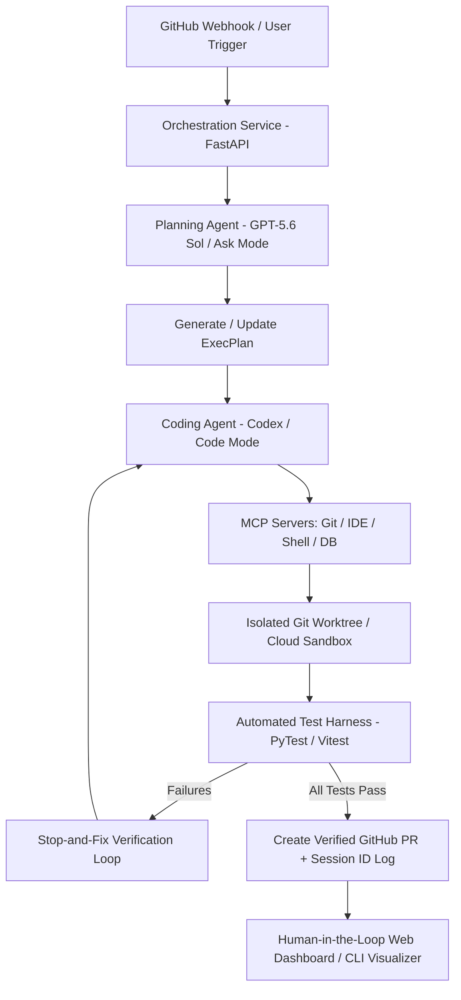

# OpenAI Build Week — Winning Blueprint & Final Strategic Recommendations

## 1. The Winning Blueprint Architecture

An ideal Build Week winning project presents an **end-to-end production-ready product** with robust architecture, clear agent workflows, and exceptional polish.

---

## 2. Core Blueprint Pillars

### A. Architecture & System Design
* **Modular Service Architecture:** Clear separation between presentation layer (React/Next.js UI), agentic orchestrator (FastAPI backend), and execution environments (Git worktrees / sandboxes).
* **Open Protocols (MCP):** Heavy utilization of Model Context Protocol (MCP) servers to seamlessly connect Codex with repository files, IDE diagnostics, and external databases.
* **Production Integrity:** Real data pipelines, clear environment scripts (`start /startup-script.js`), containerized sandboxes, and zero synthetic mocks.

### B. AI Workflow & Agent Orchestration
* **Multi-Agent Collaboration:** Dedicated roles for Planning (GPT-5.6 Sol Ask Mode), Implementation (Codex Code Mode), and Verification (Tester Harness Agent).
* **Ask Mode → Code Mode Transition:** Always construct execution plans (`ExecPlans`) in Ask Mode before triggering Code Mode implementation.
* **Stop-and-Fix Loop:** Mechanical test verification gates all code generation. If tests fail, the agent enters an automatic self-repair loop before proceeding.

### C. Context Memory & Compaction
* **Hierarchical `AGENTS.md`:** Concise root `AGENTS.md` (<100 lines) acting as a navigation index pointing to detailed sub-domain guides.
* **Server-Side Compaction:** Utilizing native context compaction (`compact_threshold` / `/responses/compact`) to maintain coherence during multi-hour development sessions.

### D. UI/UX & Demo Storytelling
* **Polished Presentation Layer:** Clean, intuitive UI highlighting real-time agent reasoning, active worktrees, and step-by-step progress.
* **Pitch-Style Narrative Video (≤3 min):**
  1. *0:00 - 0:30:* Hook & painful problem statement.
  2. *0:30 - 2:00:* Live working execution showing Codex in action (code generation, test loops, PR creation).
  3. *2:00 - 2:45:* Highlight verified Codex Session IDs, architecture diagram, and MCP integration.
  4. *2:45 - 3:00:* Impact summary and conclusion.

---

## 3. Final Strategic Recommendations

1. **Avoid Overused Paths:** Do not build generic chatbots, basic text summarizers, or simple prompt wrappers. Pick a narrow, real-world engineering pain point.
2. **Prioritize High-Impact White-Space:** Focus on the **Developer Tools** track—it offers the lowest competition, maximum alignment with OpenAI's coding-agent theme, and highest technical depth scoring.
3. **Make Codex Visible:** Explicitly showcase Codex driving multi-file refactoring, patch generation, test execution, and pull request creation. Provide verified Codex Session IDs in the repo and demo.
4. **Scope Ruthlessly:** Build one perfected, end-to-end workflow using real data. A working single feature always beats a broken multi-feature platform.
5. **Enforce Mechanical Verification:** Never merge code without running linters and test suites. Implement automated stop-and-fix loops.
